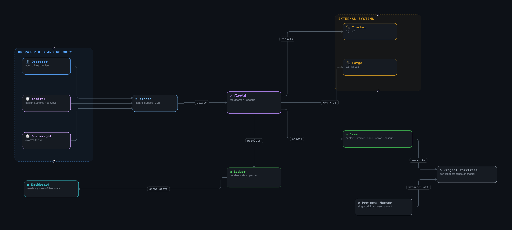

# Armada

A self-contained development armada — an always-on **fleet** — that turns 
tickets into merged code for a given project. Work is designed, produced,
and verified by a crew of agent **cogs**, coordinated by a daemon (`fleetd`) that
owns a SQLite **ledger** (the armada's state).

**`fleetc` is the interface to the running armada** — how you talk to, direct,
and query it: dispatch work, open convoys, anchor/weigh/sink cogs, and read its
plan, cogs, transcripts, and cost. `fleetd` owns the state and drives the line;
`fleetc` is the control surface.

Forward backlog: [`TODO.md`](TODO.md).



---

## Getting started

### 1. Dependencies

Homebrew is the install path for every prerequisite; the `Brewfile` is the
canonical list. The installer gates on it.

```bash
# 1. Install Homebrew (skip if present): https://brew.sh/
# 2. Install every Brewfile entry (idempotent):
brew bundle --file=./Brewfile

# 3. Set up a project — a folder projects/<name>/ holding its fleet.toml (forge, tracker,
#    cadences) and its checkout. `/fleet-new-project` (in Claude, from the repo root) asks
#    what it needs, writes the folder, and runs preflight; the tracked showcase
#    projects/armada-test/ is the worked example of every field.

# 4. Third-party backends live in third-party/
#    Keep current: re-clone, or `git -C third-party/<repo> pull`.
```

Integrations are chosen in `fleet.toml` (`[forge]`, `[tracker]`); initialize each CLI once:

- **Forges:** GitLab — `glab auth login`. GitHub — `gh auth login`; enable "Allow auto-merge" and
  protect the default branch with your CI check. GitHub has no MR dependencies, so it doesn't stack.
- **Trackers:** Jira — `jira init` (its board is the one claimed tickets join the active
  sprint of). Filesystem — no setup: a folder of `<KEY>.md` ticket files with a YAML header
  (`[tracker] path`, default `tickets/` in the project folder).

### 2. Install

```bash
make install      # gate on the Brewfile, stow the Claude surface, put fleetc on PATH
make uninstall    # reverse it (unstow; assumes the fleet is stopped)
```

`make install` uses [stow](https://www.gnu.org/software/stow/) to symlink the
agents and skills into place.

Per-deployment harness settings (auto-mode trust, permissions for *your* work or
personal systems) live in a gitignored profile, applied onto `.claude/settings.json`:

```bash
harness/apply.sh harness/profiles/<name>.json   # rebuild = committed base + profile
```

The applied file is what `make install` stows into `~/.claude`. The committed base
stays frozen: `apply.sh` marks the file `skip-worktree`, so git ignores the applied
copy. To un-apply (or to edit the base itself), clear the flag first:

```bash
git update-index --no-skip-worktree .claude/settings.json
git checkout .claude/settings.json
```

Each project's checkout carries the kit's ref guard, linked into its `.git/hooks` (every
worktree of the checkout runs it). fleetd refuses to start without it:

```bash
FLEET_PROJECT=<name> ./install.sh --hooks   # link hooks/git-hook-* into the project's checkout
```

### 3. Run

```bash
make preflight FLEET_PROJECT=<name>   # check the setup (runtime state, checkout, CLI auth, tmux + claude); `make run` gates on it
make run FLEET_PROJECT=<name>         # restart project <name>'s fleetd, then open its dashboard
make restart FLEET_PROJECT=<name>     # rebuild fleetd + reinstall fleetc, (re)start fleetd in the background
make stop FLEET_PROJECT=<name>        # stop that project's fleet daemon
make dashboard FLEET_PROJECT=<name>   # build + run the TUI dashboard
make snapshot FLEET_PROJECT=<name>    # snapshot the project's ledger → projects/<name>/exports/<name>-<UTC stamp>.db
make import FILE=<snapshot> FLEET_PROJECT=<name>   # restore a ledger snapshot (the fleet must be stopped)
make slides                           # serve the slides on :5174, until Ctrl-C
```

`export FLEET_PROJECT=<name>` once per shell and the `FLEET_PROJECT=` on each target can go.

`fleetd` self-ticks (poll / sync / reconcile cadences, set in `fleet.toml`);
`fleetc` is the control surface — run `fleetc` for its verbs.

**A project is a folder.** `projects/<name>/` holds the project's `fleet.toml`, its runtime state
in `.fleet/` (ledger, socket, telemetry, `fleetd.log`), its checkout, its ticket worktrees in
`impl/` and its lookouts' in `review/`. `fleetd`, `fleetc`, the dashboard and every cog find the
project as the nearest folder with a `fleet.toml`, starting from the current directory, or from
`-C <dir>` (`fleetc -C projects/<name> …`). Outside a project they refuse to run. One fleet runs
at a time. To switch, let the cogs finish (or `fleetc sink` them), `make stop`, then
`make run FLEET_PROJECT=<other>`. Each project's state stays in its folder, so you come back to it
exactly as you left it.

`.fleet/` is live SQLite; to keep or move a project's state, snapshot its ledger with
`make snapshot` (a consistent copy, safe beside a running fleet) and restore it with
`make import` (with the fleet stopped).

#### Dry-run

Start fleetd planning only: nothing is spawned, nothing transitioned.

```bash
FLEET_DRY_RUN=true make restart FLEET_PROJECT=<name>
fleetc settings set dry_run true      # make it stick in the ledger too
```

`dry_run` resolves the environment, then the ledger (`fleetc settings`), then `fleet.toml`: the
variable beats a live `dry_run=false` in the ledger, which beats the file. Reconcile then only plans
and logs: no spawn, heal, wake, handoff, reap, captain or lookout, so no tracker transitions and no
forge writes. Still live: the sync (it reads the tracker and forge into the ledger) and every
`fleetc` command you or a cog sends.

To go live, restart without the variable (the ledger keeps it dry), then
`fleetc settings set dry_run false`. While the variable is set, that command has no effect. Expect
a burst of queued actions on the first live tick.

### 4. Notes (optional)

The repo's markdown and each project's checkout's (the product's docs), as a
[Docusaurus](https://docusaurus.io) site in the browser, with the fleet viewer at `/fleet` and the
skills' reports (`reports/`) at `/reports/`. The site is `site/`; what it reads is in its
`docusaurus.config.js`:

```bash
make serve                            # http://localhost:5175, until Ctrl-C; reloads as pages change
```

The drawings in `demos/draw/` are Excalidraw files: open them at [excalidraw.com](https://excalidraw.com).

---

## Layout

```
armada/
├── crates/      the fleet — domain, ledger, wire, fleetd (daemon), fleetc (client)
├── apps/        standalone TUIs — crew, dashboard
├── agents/      the cogs + standing collaborators, stowed to ~/.claude/agents/
├── skills/      the kit's skills, stowed to ~/.claude/skills/
├── local/       your own skills (local/skills/<name>/), stowed alike but never committed
├── .claude/     Claude config (settings, CLAUDE.md, scripts), stowed to ~/.claude/
├── harness/     apply.sh + gitignored per-deployment settings profiles
├── hooks/       the guards: git's ref guard (linked into each checkout by `install.sh --hooks`)
│                and the lookouts' command guard (attached to each lookout by fleetd)
├── demos/       architecture decks (open-slide) + the fleet viewer's source (React Flow; served at /fleet by the notes)
├── site/        the notes: a Docusaurus site over the repo's markdown + the fleet viewer (`make serve`)
├── Brewfile     dependency manifest
├── install.sh   install / --uninstall (gates on Brewfile + stows + installs fleetc) / --hooks
├── fleet.sh     start, stop and watch a project's fleet (`make` wraps it)
├── Makefile     one-word wrappers (run `make` for the cheat sheet)
├── TODO.md      the forward backlog
├── KNOWN_ISSUES.md  accepted edge cases + workarounds
├── projects/    one folder per project: fleet.toml + .fleet/ state + checkout + impl/ (the ticket
│                worktrees) + review/ (the lookouts' review worktrees)
│                (gitignored, except the armada-test showcase's config + tickets)
└── reports/     the skills' reports, one folder per project (convoy progress, fleet spend):
                 gitignored, served by `make serve`
```
